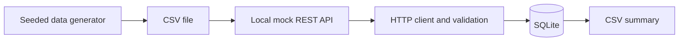

# Operations Data Pipeline

**A reproducible Python data-engineering portfolio demo featuring a fictional local API, resilient ingestion, idempotent SQLite storage, and aggregated CSV reporting.**

> [!IMPORTANT]
> **Portfolio Demonstration Notice**  
> This repository is an independently developed portfolio demonstration inspired by general technical challenges encountered during my professional experience. It uses synthetic data and fictional scenarios, contains no company source code or confidential information, and is not affiliated with or endorsed by my former or current employer.

## The problem

Recurring reporting workflows often need to ingest paginated transaction records, handle transient network failures, reject malformed inputs, prevent double counting on reruns, and produce easy-to-review summaries. This repository demonstrates a small, self-contained approach to those general engineering problems. **It is not a copy of any system used by an employer.**

## What it does

- Creates deterministic fictional transaction records with a configurable random seed.
- Serves the generated CSV through a local, paginated REST-style HTTP API.
- Fetches data with bounded retries for transient connection errors and HTTP 5xx responses.
- Validates data types, amount precision, allowed categories/statuses and synthetic IDs.
- Stores new records in SQLite with primary-key deduplication.
- Exports category-by-status totals to CSV; repeated runs do not double count.
- Runs with Python's standard library; uses `pytest` for development tests.

## Tech stack

Python 3.10+, Python standard library (`http.server`, `urllib`, `sqlite3`, `csv`, `decimal`, `argparse`), pytest and GitHub Actions.

## Architecture



See [docs/architecture.md](docs/architecture.md) for design decisions, threat boundaries and trade-offs.

## Quick start

In a terminal with Python 3.10+:

```bash
python -m venv .venv
# Linux / macOS:
source .venv/bin/activate
# Windows PowerShell:
# .venv\Scripts\Activate.ps1
python -m pip install -e '.[dev]'
ops-pipeline generate --count 100 --seed 42
```

Open **terminal A**, from the repository root:

```bash
ops-pipeline serve
```

Open **terminal B**, from the repository root:

```bash
ops-pipeline run
ops-pipeline run  # newly inserted = 0; idempotent rerun
```

The files `output/operations.db` and `output/summary.csv` are created locally and are ignored by Git. Stop the server with Ctrl+C. Alternative without installation: `PYTHONPATH=src python -m operations_pipeline ...` (Linux/macOS).

### Example mock API response

`GET http://127.0.0.1:8765/transactions?page=1&limit=2`

```json
{
  "items": [
    {"transaction_id": "DEMO-000001", "customer_id": "SYN-0004", "date": "2025-01-10", "category": "books", "amount": "20.00", "status": "completed"}
  ],
  "page": 1,
  "next_page": 2
}
```

The example is illustrative; actual generated rows depend on the seed and can differ.

### Example CSV report format

```csv
category,status,transaction_count,total_amount
books,completed,12,1450.30
home,pending,3,99.99
```

The figures above are illustrative, not performance claims or employer data.

## Synthetic dataset

`ops-pipeline generate --output data/synthetic_transactions.csv --count 100 --seed 42` produces entirely invented `DEMO-` transaction IDs, `SYN-` customer IDs, fictional dates, product categories, statuses and amounts. Reusing the seed generates identical output. The generator contains no learned distributions or source-derived records. `data/synthetic_transactions.csv` is committed only as a deliberately generated sample.

## Test and verify

```bash
python -m pytest
```

Tests cover repeatable generation, validation failures, pagination, a full API-to-SQLite-to-report integration test, idempotent reruns and API boundary restrictions. CI runs these tests on Python 3.10 and 3.13.

## Configuration

See `.env.example` for optional illustrative environment variable names. This application reads selected variables from your shell environment; it does not automatically load `.env` files. It refuses non-loopback API endpoints. Only a local mock API is supported.

## Engineering decisions

- **Dependable reruns:** unique IDs prevent duplicate transactions.
- **Explicit validation:** invalid records fail early rather than silently contaminating aggregates.
- **Stable currency calculations:** SQLite stores integer cents.
- **Controlled failures:** retries have a finite budget and are restricted to recoverable errors.
- **Small attack surface:** no corporate integrations, secrets, or external network dependencies.
- **Scope discipline:** no unnecessary container orchestration, distributed queue, or cloud infrastructure.

## Known limitations and future improvements

This demonstration is append-only: a changed record with the same ID will not overwrite an existing row. Possible future improvements include schema-versioned migrations, upsert policies, fault-injection tests, OpenTelemetry metrics, and optional dashboards if requirements justify them.

## Skills demonstrated

Python packaging, data engineering, API integration, defensive programming, deterministic test fixtures, SQL persistence, aggregate analytics, testing, continuous integration and technical documentation.

## Publication and intellectual property

This project was written as an independent demonstration, without copying employer source code, datasets, business logic, internal SQL, or private infrastructure. It includes no code license; all rights are reserved unless a license is later granted. The author should still conduct a final publication review of the actual Git repository and its history prior to making it public.
