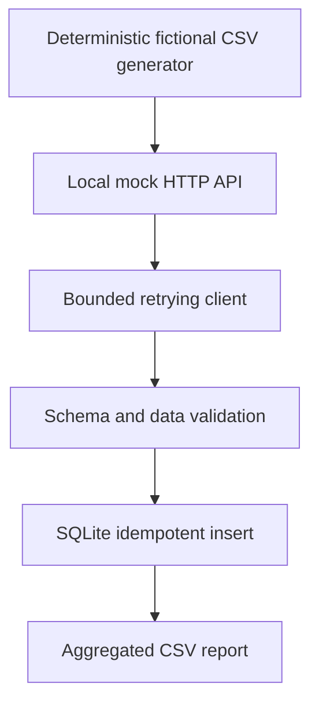

# Architecture and threat boundaries

The entire application operates on localhost. `generate` emits deliberately fictional identifiers (`SYN-` and `DEMO-`) and seeded records. The HTTP server listens on loopback only; the HTTP client accepts loopback URLs only. No authentication to any business service or cloud resource is implemented. Database uniqueness prevents duplicate inserts across reruns. Money uses integer cents for storage. Aggregation is by category and status, not by person.

## Decisions

- **Standard-library runtime:** no third-party infrastructure or mandatory services.
- **Small package:** explicit modules rather than service frameworks for a bounded demo.
- **Pagination:** explicit next-page contract and guard against malformed sequences.
- **Retries:** bounded exponential delays for transport errors and HTTP 5xx, not 4xx.
- **Idempotency:** `INSERT OR IGNORE` on a stable transaction ID; this is append-only and does not update previously seen records.
- **Precision:** validate decimals and store cents as integers.
- **Privacy:** no source-derived models, identifiers, datasets, endpoints, or screenshots.

## Limitations

This is not a production deployment. It does not offer exactly-once delivery, distributed concurrency coordination, authentication, event streaming, schema migrations, or monitoring. These would be appropriate only if requirements justified them. The demo never calls corporate infrastructure.
